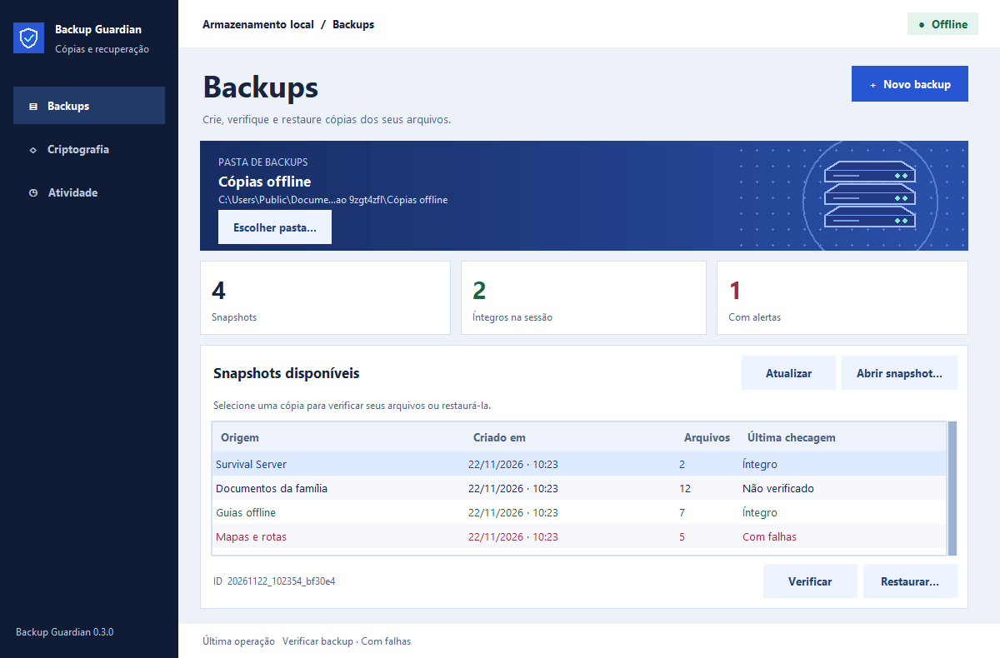
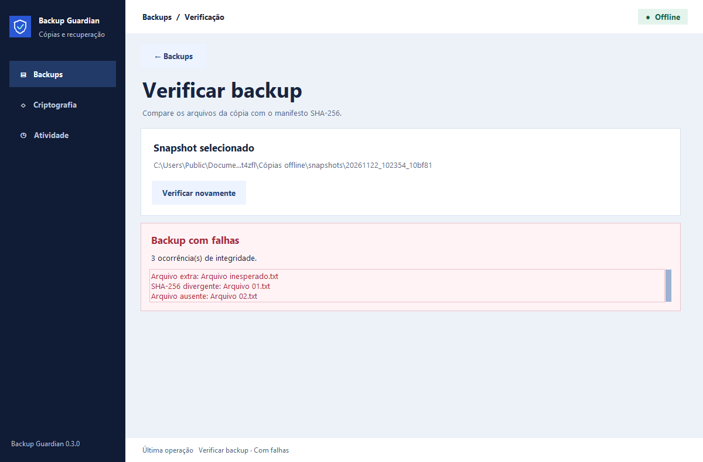
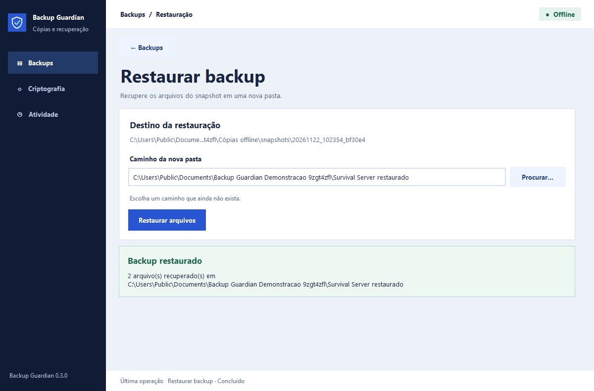
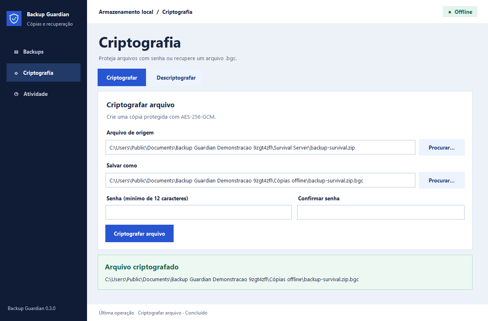

<div align="center">
  <p><strong>Backups verificáveis, restauração segura e criptografia de arquivos para Windows e Linux.</strong></p>
  <p>
    
    
    
    
    
  </p>
</div>

<div align="center">
  <a href="screenshots/painel.png"></a>
  <br>
  <sub>Painel de snapshots da pasta selecionada.</sub>
</div>

---

## 🛡️ Sobre

**Backup Guardian** é uma ferramenta de backup e recuperação de arquivos com interface gráfica e linha de comando. Permite criar cópias de pastas, verificar a integridade do conteúdo e restaurar arquivos a partir de snapshots, sem depender de serviços em nuvem.

O projeto é compatível com **Windows e Linux**, incluindo ambientes Linux no **Raspberry Pi**. Depois de preparar as dependências, pode ser utilizado sem conexão com a internet.

---

## ✨ Funcionalidades

- Criação de **snapshots** de pastas com cópias dos arquivos e manifesto de integridade.
- Verificação por **SHA-256** para identificar arquivos alterados, ausentes ou inesperados.
- Restauração com validação prévia e proteção contra substituição de destinos existentes.
- Preservação de **pastas vazias** nos snapshots criados a partir da versão 0.2.
- Leitura de snapshots da versão 0.1, respeitando os limites de dados registrados naquela versão.
- Painel de snapshots por pasta de backups, com ações de criação, verificação e restauração.
- Acompanhamento de operações e resultados na atividade da sessão.
- Criptografia e descriptografia de arquivos com senha pela interface ou pelos comandos `seal` e `unseal`.
- Interface gráfica com **Tkinter**, acesso por terminal e operação offline.
- Integração com o **[Survival Server](https://github.com/odevfigueiredo/SurvivalServer.git)** para proteger arquivos de backup exportados pelo servidor.

---

## 📸 Galeria

Capturas do app em execução no Windows com dados de demonstração. Clique para abrir em tamanho completo.

<table>
  <tr>
    <td width="50%" align="center">
      <a href="screenshots/verificacao.png"></a>
      <br><sub>Verificação de integridade</sub>
    </td>
    <td width="50%" align="center">
      <a href="screenshots/restauracao.png"></a>
      <br><sub>Restauração</sub>
    </td>
  </tr>
</table>

<div align="center">
  <a href="screenshots/criptografia.png"></a>
  <br><sub>Criptografia concluída para um backup do Survival Server.</sub>
</div>

---

## 🧱 Tecnologias

<div align="center">
  
  
  
  
  
  
</div>

---

## 🗂️ Arquivos principais

```text
BackupGuardian/
├── .github/
│   └── workflows/
│       └── python-ci-backupguardian.yml
├── docs/                          # Pesquisa e decisões de projeto
├── screenshots/                   # Capturas da interface
├── tests/                         # Testes automatizados
├── backup_guardian.py             # Ferramenta de linha de comando
├── guardian_gui.py                # Interface gráfica
├── guardian_theme.py              # Tema e componentes visuais
├── iniciar_windows.bat            # Inicialização no Windows
├── iniciar_linux.sh               # Inicialização no Linux
├── requirements-crypto.txt        # Dependência de criptografia
└── README.md
```

---

## 🚀 Como começar

### 1. Requisitos

- **Python 3.10 ou superior**.
- **Tkinter** para a interface gráfica. Ele pode exigir instalação separada no Linux. Use `python -m tkinter` para conferir se está disponível.
- **`cryptography`** para criptografar e descriptografar arquivos, tanto pela interface quanto pelo terminal. Os fluxos de snapshot usam a biblioteca padrão.

### 2. Obtenha o projeto

Clone o repositório pelo Git ou baixe seu conteúdo como ZIP no GitHub.

```bash
git clone https://github.com/odevfigueiredo/BackupGuardian.git
cd BackupGuardian
```

### 3. Abra a interface gráfica

**Windows:** execute `iniciar_windows.bat`.

**Linux / Raspberry Pi:**

```bash
sh iniciar_linux.sh
```

Se estiver usando um ambiente virtual com a dependência de criptografia instalada, você também pode iniciar a interface diretamente:

```bash
python guardian_gui.py
```

> Nos comandos, substitua `python` por `python3` (Linux) ou `py -3` (Windows) se necessário.

---

## 💾 Criar e recuperar backups

### Pela interface

1. Selecione a pasta de backups no painel. Ela reúne os snapshots disponíveis.
2. Para criar um snapshot, escolha a pasta de origem e inicie a cópia.
3. Selecione um snapshot na lista para verificar a integridade. Consulte o resultado na interface.
4. Para restaurar, selecione o snapshot e escolha uma pasta de destino que ainda não exista. Acompanhe o resultado na atividade da sessão.

### Pelo terminal

**Crie um snapshot:**

```bash
python backup_guardian.py create "./Meus Documentos" "E:/Copias"
```

**Liste os backups disponíveis:**

```bash
python backup_guardian.py list "E:/Copias"
```

**Verifique a integridade de um snapshot:**

```bash
python backup_guardian.py verify "E:/Copias/snapshots/ID_DO_BACKUP"
```

**Restaure o snapshot:**

```bash
python backup_guardian.py restore "E:/Copias/snapshots/ID_DO_BACKUP" "./Documentos Recuperados"
```

Substitua os caminhos pelos diretórios do seu computador e use o identificador retornado pelos comandos `create` ou `list`. **Escolha um destino que ainda não exista** para a restauração.

Cada snapshot contém uma cópia dos dados e um manifesto com hashes SHA-256. A verificação detecta diferenças em relação a esse manifesto. Novos snapshots exigem nomes de arquivos portáveis entre Windows e Linux.

---

## 🔐 Criptografia e privacidade

Na tela **Criptografia**, escolha se quer proteger um arquivo ou recuperar um `.bgc`. Informe o arquivo de origem, um destino novo e a senha. As mesmas operações estão disponíveis no terminal com `seal` e `unseal`. O formato `BGUARD1` usa **AES-256-GCM** e deriva a chave com **scrypt**.

**Criptografe um arquivo:**

```bash
python backup_guardian.py seal "arquivo.zip" "arquivo.zip.bgc"
```

**Recupere o arquivo:**

```bash
python backup_guardian.py unseal "arquivo.zip.bgc" "arquivo-recuperado.zip"
```

A senha deve ter **pelo menos 12 caracteres**. Na recuperação, a autenticidade do arquivo é verificada antes de publicar o conteúdo descriptografado.

> **Importante:** snapshots comuns **não são criptografados automaticamente**. Para proteger um snapshot completo, compacte a pasta do snapshot em um ZIP e depois aplique `seal`. Mantenha a senha em local seguro: a perda da senha pode impedir a recuperação dos dados.

### Preparar a criptografia para uso offline

Em um computador conectado com sistema, arquitetura e versão do Python compatíveis com a máquina de destino, baixe os pacotes necessários:

```bash
python -m pip download --only-binary=:all: -r requirements-crypto.txt -d pacotes
```

Transfira a pasta `pacotes` e o projeto para a máquina offline. Na pasta do Backup Guardian, instale a dependência sem acessar a internet:

```bash
python -m pip install --no-index --find-links ./pacotes -r requirements-crypto.txt
```

---

## 🔄 Integração com o [Survival Server](https://github.com/odevfigueiredo/SurvivalServer.git)

O Backup Guardian também pode criptografar backups gerados pelo [Survival Server](https://github.com/odevfigueiredo/SurvivalServer.git). O formato atual BGUARD1 admite até 64 GiB menos 32 bytes por arquivo. [NIST SP 800-38D, seção 5.2.1.1](https://nvlpubs.nist.gov/nistpubs/Legacy/SP/nistspecialpublication800-38d.pdf)

**1.** Na pasta do [Survival Server](https://github.com/odevfigueiredo/SurvivalServer.git), gere uma cópia consistente do banco de dados e arquivos:

```bash
python server.py backup "../BackupGuardian/backup-survival.zip"
```

**2.** Na pasta do Backup Guardian, criptografe o ZIP:

```bash
python backup_guardian.py seal "backup-survival.zip" "E:/Copias/backup-survival.zip.bgc"
```

**3.** Para recuperar, descriptografe o arquivo:

```bash
python backup_guardian.py unseal "E:/Copias/backup-survival.zip.bgc" "backup-restaurado.zip"
```

**4.** Pare o [Survival Server](https://github.com/odevfigueiredo/SurvivalServer.git) e, na pasta dele, restaure o backup:

```bash
python server.py restore "../BackupGuardian/backup-restaurado.zip" --yes
```

Ajuste os caminhos de acordo com a localização dos dois projetos.

---

## 🧪 Testes e qualidade

Execute a suíte de testes na raiz do projeto:

```bash
python -m unittest discover -s tests -v
```

O teste da interface no Windows conferiu o diagnóstico de arquivos alterados, ausentes e extras, a restauração de pastas vazias e a rejeição de senha incorreta. O ZIP de teste do Survival Server foi criptografado, descriptografado e restaurado com o arquivo, a conta e o plano familiar.

O GitHub Actions instala a dependência de criptografia, verifica a sintaxe dos módulos e roda a suíte no Windows e no Linux com Python 3.10 e 3.12. [Workflow de testes](.github/workflows/python-ci-backupguardian.yml)

---

## 📌 Boas práticas de backup

- Pela **regra 3-2-1**, mantenha três cópias em dois tipos de mídia, com uma delas em outro local.
- Guarde uma cópia criptografada dos dados críticos em mídia desconectada e teste a recuperação periodicamente. [Guia StopRansomware da CISA](https://www.cisa.gov/sites/default/files/2025-03/StopRansomware-Guide%20508.pdf#page=5)
- Verifique o conteúdo dos snapshots e faça uma restauração de teste para uma pasta separada. [Verificação de integridade no restic](https://restic.readthedocs.io/en/stable/045_working_with_repos.html#checking-integrity-and-consistency), [Restauração no Histórico de Arquivos da Microsoft](https://support.microsoft.com/pt-br/windows/experience/backup-recovery/backup-and-restore-with-file-history)
- Evite copiar arquivos que estão sendo modificados. Para o Survival Server, use `server.py backup`.
- Guarde senhas e chaves de recuperação separadamente dos dispositivos de armazenamento.

---

## 🧭 Próximos passos

A [pesquisa e as decisões de projeto](docs/DECISOES_DE_PROJETO.md) detalham as opções de interface, a validação de backups e as prioridades de evolução.

- Ampliar os testes de restauração e compatibilidade entre sistemas operacionais.
- Melhorar a experiência da interface gráfica e as mensagens de diagnóstico.
- Expandir a documentação de recuperação em situações de emergência.
- Avaliar mecanismos adicionais de automação e agendamento de backups.

---

<div align="center">
  <p>Desenvolvido por <a href="https://github.com/odevfigueiredo">Jonatha Figueiredo</a></p>
  
</div>
